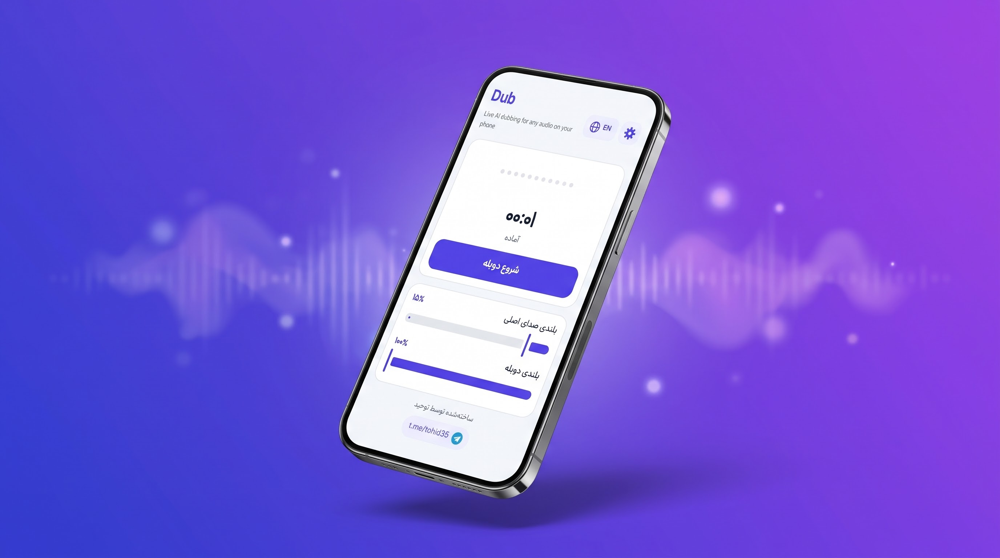

# 🎙️دوبلهٔ زندهٔ روی گوشی

اپ **Dub** صدای هر برنامه‌ای روی گوشی (یوتیوب، ویدیو، پادکست، کلاس آنلاین و …) را به‌صورت زنده می‌گیرد، با مدل ترجمهٔ زندهٔ **Gemini** به زبان دلخواه شما ترجمه می‌کند و دوبله را همان لحظه پخش می‌کند.

  

## ✨ امکانات

- دوبلهٔ زنده با پشتیبانی از **بیش از ۴۰ زبان** (فارسی، انگلیسی، عربی، ترکی، روسی، چینی، ژاپنی و …)
- گرفتن صدای داخلی گوشی (Audio Playback Capture)، بدون نیاز به میکروفون
- تنظیم جداگانهٔ بلندی **صدای اصلی** و **صدای دوبله**
- حباب شناور روی صفحه برای کنترل سریع
- ذخیرهٔ خروجی به‌صورت فایل صوتی `.wav` و زیرنویس `.srt` (اختیاری)
- شمارندهٔ مصرف روزانه و **سقف روزانه** برای جلوگیری از هزینهٔ ناخواسته
- ذخیرهٔ کلید API به‌صورت **رمزشده** با Android Keystore
- رابط فارسی و انگلیسی

## 📋 پیش‌نیازها

- اندروید **۱۰ یا بالاتر**
- یک **کلید API جمینای** (رایگان از [Google AI Studio](https://aistudio.google.com/apikey))
- اتصال اینترنت

## 📥 نصب

1. به بخش [**Releases**](../../releases) همین ریپو برو.
2. آخرین فایل `.apk` را دانلود کن.
3. فایل را باز کن و اجازهٔ نصب از منبع ناشناس را بده.

## 🚀 نحوهٔ استفاده

1. اپ را باز کن و کلید API را وارد کن.
2. زبان مقصد را انتخاب کن.
3. مجوزهای میکروفون، اعلان و نمایش روی سایر برنامه‌ها را بده.
4. روی **شروع** بزن و در پنجرهٔ ضبط صفحه، اجازه بده.
5. ویدیو یا صدای موردنظر را پخش کن؛ دوبله خودکار شروع می‌شود.

فایل‌های خروجی در مسیر `Download/Dub/` ذخیره می‌شوند.

## ⚠️ نکته‌ها و محدودیت‌ها

- در اندروید ۱۴ به بعد، در پنجرهٔ ضبط گزینهٔ **«کل صفحه»** را انتخاب کن تا صدای همهٔ برنامه‌ها گرفته شود.
- تماس صوتی/تصویری و برنامه‌هایی که ضبط صدا را ممنوع کرده‌اند (مثل نتفلیکس) قابل دوبله نیستند.
- برای بهترین نتیجه از **هدفون** استفاده کن.
- استفاده از API جمینای ممکن است هزینه داشته باشد. عدد دقیق مصرف را داشبورد گوگل نشان می‌دهد و ارقام داخل اپ فقط تخمینی هستند.

## 🔒 حریم خصوصی

- کلید API فقط روی همین گوشی و رمزشده نگهداری می‌شود.
- صدا و کلید فقط به سرورهای گوگل ارسال می‌شوند و جای دیگری فرستاده نمی‌شوند.

---

  <b>👤 سازنده: توحید</b>

  

